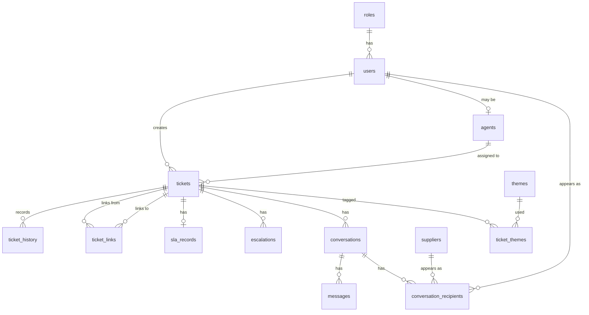

# Step 0.1 - ER diagram (draft v1)

Owner: Shivanshu. Mansi and Sunny: add or change columns your modules need.
Only Shivanshu edits models later, so settle changes now.

## Tables

| Table | Owner | Columns |
|---|---|---|
| roles | Shivanshu | id, name (admin/manager/agent/viewer, unique) |
| users | Shivanshu | id, email (unique), full_name, password_hash, role_id, is_active, created_at |
| agents | Mansi | id, user_id (unique), team, skills (json list), status (available/on_leave/at_capacity), max_open_tickets |
| tickets | Shivanshu | id, title, description, status, priority, intent, agency_name, booking_number, travel_date, team, created_by (user), assignee_agent_id, sla_due_at, is_escalated, created_at, updated_at |
| ticket_history | Shivanshu | id, ticket_id, actor_user_id, event_type, field, old_value, new_value, created_at |
| ticket_links | Mansi | id, ticket_id, related_ticket_id, link_type (booking/agency/intent/manual), match_score, reason, created_by, created_at |
| routing_rules | Mansi | id, name, match_field, match_value, target_team, priority_order, is_active |
| sla_records | Mansi | id, ticket_id (unique), priority, due_at, status (on_track/at_risk/breached/met), breached_at |
| escalations | Mansi | id, ticket_id, escalated_by_user, escalated_to_user, reason, trigger (manual/auto), created_at |
| suppliers | Sunny | id, name, contact_name, email, phone, is_active |
| conversations | Sunny | id, ticket_id, subject, status (open/closed), created_by, created_at |
| conversation_recipients | Sunny | id, conversation_id, user_id (nullable), supplier_id (nullable), added_at. Exactly one of user_id / supplier_id is set |
| messages | Sunny | id, conversation_id, sender_user_id, body, attachments (json), created_at |
| themes | Sunny | id, name (unique), description |
| ticket_themes | Sunny | ticket_id, theme_id, source (ai/manual), confidence |
| reports | Sunny | id, period_start, period_end, content (json), generated_at |

Conventions: integer primary keys named `id`, `created_at` in UTC, soft states via status columns (no hard deletes of tickets).
